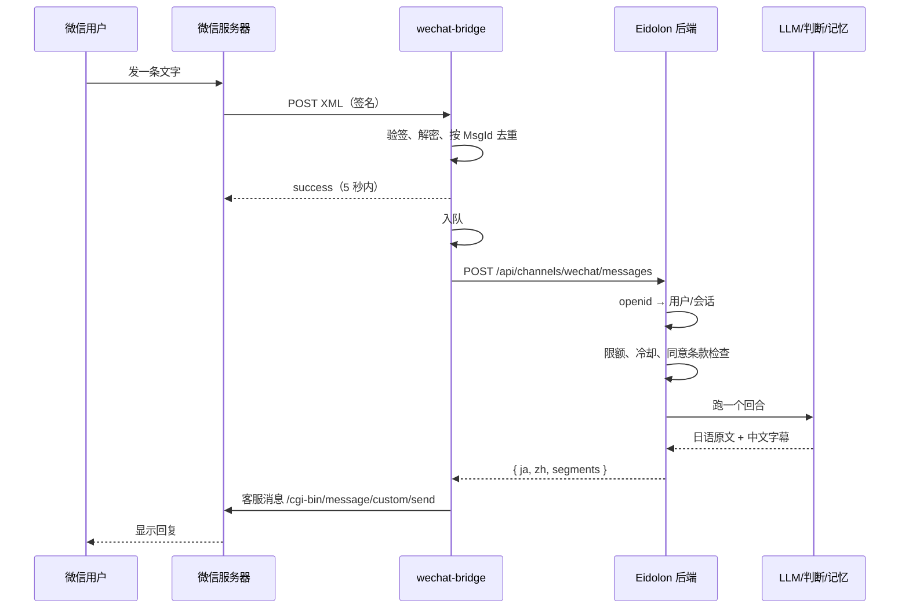

# 把 Eidolon-SC 接到微信：可行方案与实现设计

> **状态**：设计稿。仓库目前**没有**微信接入代码；这篇文档说明要做到「微信发一句话，小偶像用微信回话」需要改什么、怎么部署、有哪些限制。
>
> **适用**：已经按 [`deploy.md`](deploy.md) 用 `docker-compose.prod.yml` 部署到服务器的实例。
>
> **一句话结论**：可以做，但不是「微信直接 POST 到你的 IP:端口」。微信只会调用你在公众平台配置的**回调 URL**（必须是 http/https 的 80/443 端口，消息体是 XML）；你需要一个 bridge 服务接住消息、转给 Eidolon 后端，再把回复通过微信的**客服消息接口**发回去。

---

## 1. 先纠正三个常见误解

### 1.1 微信不会直接发到任意 IP:端口

公众号/服务号的「服务器配置」里填的是一个 URL：

- 必须以 `http://` 或 `https://` 开头；
- 只支持 **80 和 443** 端口；
- 消息体只支持 **XML**；
- 微信会先发一个 GET 请求做签名验证，通过后才开始 POST 消息。

所以你不能让微信直接访问 `http://1.2.3.4:8100`。正确做法是：

```text
https://wx.example.com/wechat/callback
        │
        ▼
      Caddy（443，证书）
        │
        ▼
  wechat-bridge（本机 127.0.0.1:8100）
```

### 1.2 个人微信没有官方机器人接口

- 个人微信没有开放的「收消息/发消息」API。
- 基于 iPad/Mac 协议、Hook、网页版自动化的方案（Wechaty 的 padlocal、itchat 等）属于第三方逆向，违反微信服务协议，账号可能被限制或封禁。
- 只给自己做实验可以玩，但**不要拿它做公开部署**，也不要绑定你的主微信号。

要做成能长期运行的服务，走**公众号/服务号**或**企业微信**。

### 1.3 微信的「5 秒」和 LLM 的「几十秒」冲突

微信服务器发来消息后，如果你 5 秒内没有响应，它会断开并**重试三次**；三次都失败，用户会看到「该公众号暂时无法提供服务」。

LLM 一个回合通常要几秒到几十秒，不可能在 5 秒内生成完整回复。正确做法是：

1. 5 秒内直接回复字符串 `success`（或空串），告诉微信「收到了」；
2. 在后台异步跑回合；
3. 用**客服消息接口**把结果主动发给用户。

客服消息的额度是：用户发一条消息后，**48 小时内最多 5 条**。所以一条文字回复没问题；如果要同时发文字 + 语音 + 照片，要控制在 5 条以内。

---

## 2. 三种可选入口

| 入口 | 用户体验 | 接入方式 | 回复限制 | 适合 | 主要难点 |
|---|---|---|---|---|---|
| **公众号/服务号** | 在微信聊天窗口里直接发消息 | 服务器配置 URL + 客服消息接口 | 被动回复 5 秒；客服消息 48 小时 5 条 | 面向微信用户、公开使用 | 认证、客服接口权限、域名/备案 |
| **企业微信自建应用** | 用户要装企业微信，在应用里聊 | 接收消息回调 + `message/send` | 被动回复 5 秒；应用消息可主动发 | 内部团队、小圈子 | 企业认证；外部联系人要用「客户联系」接口，权限更复杂 |
| **微信小程序** | 在小程序里聊天，不是微信聊天窗口 | 自己写页面 + 调后端 | 没有 5 秒限制 | 想要语音/照片/流式体验 | 小程序审核、类目、域名白名单；要另做 UI |
| **个人微信** | 和平时聊天一样 | 无官方 API | — | 只适合个人实验 | 违反协议、封号风险，**不推荐** |

**先确认你的主体类型**：

- **个人主体**通常只能注册**订阅号**，不能注册服务号；服务号和企业微信一般需要企业/组织主体。
- 个人订阅号能不能拿到**客服消息接口权限**、能不能认证，以公众平台后台的「接口权限」页为准。拿不到客服接口，就只能 5 秒内被动回复，LLM 做不到，这条路就走不通。
- 没有企业主体时，更现实的选择是**小程序**（个人可注册，但类目和能力有限）或先不接微信。
- 有企业/组织主体时，优先**服务号**；客服接口和菜单能力更完整。

**推荐顺序**：

1. 想「在微信里直接聊天、给朋友用」→ **认证公众号/服务号**（优先服务号；先确认客服接口权限）。
2. 只给公司/小团队内部用 → **企业微信自建应用**。
3. 想要完整语音/照片体验、不介意另开一个入口 → **小程序**。
4. 个人微信 → 不建议。

---

## 3. 推荐架构

```text
微信用户
   │ 发文字/语音
   ▼
微信服务器
   │ HTTPS POST XML（80/443）
   ▼
Caddy（wx.example.com，自动证书）
   │
   ▼
wechat-bridge（独立容器，127.0.0.1:8100）
   │  1. 验签/解密
   │  2. 按 MsgId 去重
   │  3. 5 秒内回 success
   │  4. 入队
   ▼
worker（同容器）
   │  POST /api/channels/wechat/messages
   │  Authorization: Bearer <EIDOLON_CHANNEL_TOKEN>
   ▼
Eidolon 后端（127.0.0.1:8000）
   │  限额 → 判断模型 → 检索/记忆 → 对话模型
   ▼
返回 { ja, zh, segments, photo_id? }
   │
   ▼
wechat-bridge
   │  POST /cgi-bin/message/custom/send
   ▼
微信用户收到回复
```

### 为什么建议把 bridge 单独放一个容器

- 微信的验签、AES 解密、XML 解析、access_token 缓存、重试队列都不适合塞进现有的 FastAPI 回合逻辑里。
- bridge 可以独立重启、独立扩容、独立看日志。
- 后端只新增一组「受 service token 保护」的 channel API，不直接暴露给公网。

> 如果只想先做一个最小可用版，也可以把 webhook 直接写进后端（`/api/wechat/callback`），通过现有的 Next `/api/*` 代理转发。这样少一个容器，但微信的重试和长任务会占用后端进程，生产环境不如独立 bridge 稳。

---

## 4. 一次消息的完整时序



关键点：

- **先 ack，再处理**：微信的 5 秒限制只针对 HTTP 响应，不要求你 5 秒内生成回复。
- **按 MsgId 去重**：微信重试时同一条消息可能来三次，不能回三遍。
- **按 openid 串行**：同一个用户连发两条，要按顺序处理，避免回复乱序。
- **发送失败要重试**：客服消息接口可能限流/网络失败；用 outbox 表记录状态，指数退避重试，超过次数告警。

---

## 5. 微信侧准备

### 5.1 公众号/服务号

> **先查主体和接口权限**：个人主体一般只能注册订阅号；服务号通常要企业/组织。注册前先在公众平台看「接口权限」里有没有**客服消息**。没有客服接口，异步回复做不了，只能 5 秒内被动回复，不适合 LLM。

1. 注册公众号，完成**微信认证**（认证有费用、且可能需要企业主体，以公众平台为准）。
2. 在「开发 → 基本配置」拿到 **AppID** 和 **AppSecret**。
3. 在「开发 → 基本配置 → 服务器配置」填：
   - URL：`https://wx.example.com/wechat/callback`
   - Token：自己生成一个随机串；
   - EncodingAESKey：随机生成；
   - 消息加解密方式：**安全模式**（推荐）；
   - 数据格式：XML。
4. 确认账号具备**客服消息接口权限**。没有这个权限，就只能被动回复，而被动回复必须在 5 秒内完成，LLM 做不到。
5. 在「自动回复」里不要和服务器配置冲突：启用服务器配置后，公众平台里设置的自动回复和自定义菜单会失效。
6. 把隐私政策、使用条款、删除数据方式的链接放进菜单或欢迎语。

### 5.2 域名和网络

- 需要一个能解析到你服务器的域名，例如 `wx.example.com`。
- Caddy 自动申请 HTTPS 证书；微信要求 80/443，Caddy 正好处理。
- 服务器在国内时，域名通常要备案；在海外时以微信公众平台的校验为准。
- 不要把后端 `8000` 或 bridge `8100` 直接暴露到公网；只开 Caddy 的 80/443。

### 5.3 企业微信（如果走这条）

- 注册企业微信，创建自建应用，配置「接收消息」回调（同样要 URL、Token、EncodingAESKey）。
- 内部成员用应用消息接口 `message/send` 主动发。
- 如果要和微信外部联系人聊，需要开通「客户联系」，用外部联系人相关接口；权限和审核比公众号复杂。
- 企业微信的接口文档：[发送消息](https://developer.work.weixin.qq.com/document/path/94700)。

---

## 6. 服务器侧改动

### 6.1 新增 bridge 服务

在 `docker-compose.prod.yml` 里加一个服务（示意）：

```yaml
  wechat:
    build: ./wechat
    network_mode: host
    env_file: .env
    environment:
      HOST: 127.0.0.1
      PORT: 8100
      EIDOLON_BASE_URL: http://127.0.0.1:8000
    volumes:
      - wechat-data:/data
    restart: unless-stopped
    logging: *logging
```

`wechat-data` 用来放 bridge 自己的 outbox/去重表（SQLite 就够）。不要把它和后端数据库混在一起。

### 6.2 Caddy

推荐用独立子域名，避免改主站配置：

```caddyfile
wx.{$EIDOLON_DOMAIN} {
	reverse_proxy 127.0.0.1:8100
}
```

然后：

- DNS 加一条 `wx` 的 A/AAAA 记录；
- 重新加载 Caddy；
- 公众号服务器 URL 填 `https://wx.你的域名/wechat/callback`。

如果一定要用主域名路径（`https://你的域名/wechat/*`），需要在现有站点块里加 `handle /wechat/*`，并把原来的 `reverse_proxy 127.0.0.1:3000` 放进 `handle` 块；改之前先备份 Caddyfile。

### 6.3 `.env` 新增

```sh
# 微信
WECHAT_APP_ID=...
WECHAT_APP_SECRET=...
WECHAT_TOKEN=...                 # 公众号后台填的 Token
WECHAT_AES_KEY=...               # EncodingAESKey，安全模式必填
WECHAT_CALLBACK_PATH=/wechat/callback
WECHAT_DEFAULT_CHARACTER=mano    # 默认和哪位角色聊
WECHAT_CUSTOMER_SERVICE=1        # 用客服消息异步回复；0 只做被动回复（不推荐）

# bridge 调后端用的 service token，随机 32 字节以上
EIDOLON_CHANNEL_TOKEN=...

# 可选
WECHAT_MAX_REPLY_CHARS=1800      # 单条文本上限，按微信实际限制再调
WECHAT_DAILY_MESSAGES_PER_USER=200
```

`WECHAT_APP_SECRET`、`WECHAT_AES_KEY`、`EIDOLON_CHANNEL_TOKEN` 都是密钥，不要提交进仓库，不要写进日志。

---

## 7. 后端要新增的接口

### 7.1 鉴权

所有 `/api/channels/*` 接口只接受：

```http
Authorization: Bearer <EIDOLON_CHANNEL_TOKEN>
```

- 没有 token → 401；
- token 错误 → 401；
- 这组接口不要求浏览器的 session cookie，也不要求 `Origin`；
- 后端只监听 `127.0.0.1`；这组接口即使经 Caddy/Next 的 `/api` 可达，也必须带 token，不能匿名调用。

### 7.2 接口契约

#### `POST /api/channels/wechat/messages`

```json
{
  "openid": "oXXXXXXXXXXXXXXXXXXXXXXXXXXX",
  "message_id": "1234567890123456789",
  "text": "今天好累啊",
  "character_id": "mano"
}
```

返回：

```json
{
  "status": "ok",
  "user_id": "7f...",
  "conversation_id": "9a...",
  "reply": {
    "ja": "お疲れさま……今日はちゃんと休めましたか？",
    "zh": "辛苦啦……今天有好好休息吗？",
    "segments": [
      {"ja": "お疲れさま……", "zh": "辛苦啦……"},
      {"ja": "今日はちゃんと休めましたか？", "zh": "今天有好好休息吗？"}
    ],
    "photo_id": null
  }
}
```

错误：

| 状态 | 含义 | bridge 怎么回用户 |
|---|---|---|
| 401 | service token 不对 | 不回复，记日志 |
| 404 | 角色不存在 | 「这位角色暂时不在」 |
| 409 | 她正在冷却 | 带上 `retry_at`，「她还在生气，X 点后再来」 |
| 422 | 文本为空/太长 | 「这句话太长了」 |
| 428 | 还没同意隐私政策/条款 | 发同意提示和链接 |
| 429 | 限额用完 | 带上 `retry_at`，「今天的次数用完了」 |
| 502 | 模型/服务失败 | 「她现在没法回复，稍后再试」 |
| 503 | 服务不可用 | 同上 |

#### `POST /api/channels/wechat/consent`

```json
{"openid": "...", "agreed": true}
```

- `agreed=true`：写 `users.consented_at`，之后可以正常聊天；
- `agreed=false`：不写，回复「已取消」。

#### `GET /api/channels/wechat/characters`

返回角色列表，给「换人」菜单用：

```json
[
  {"id": "mano", "name": "櫻木真乃", "name_zh": "樱木真乃"},
  {"id": "chiyuki", "name": "七草はづき", "name_zh": "七草叶月"}
]
```

#### `POST /api/channels/wechat/character`

```json
{"openid": "...", "character_id": "chiyuki"}
```

切换默认角色；下一条消息开始用新角色。每个角色各有自己的对话。

#### `DELETE /api/channels/wechat/me`

```json
{"openid": "...", "confirm": "删除我的数据"}
```

删除这位微信用户及其全部数据；和用户自己点「删除我的全部数据」一样。删除后，同一条微信再发消息会创建新用户（除非被封禁过，见 10.6）。

### 7.3 后端实现

建议新增：

- `backend/src/eidolon/channels.py`：openid ↔ 用户、会话选择、回复收集、同意/删除；
- `backend/src/eidolon/channel_api.py`：上面的 HTTP 路由；
- `backend/src/eidolon/store.py`：`channel_identities`、`channel_messages`、`channel_bans` 的读写；
- `backend/src/eidolon/config.py`：`EIDOLON_CHANNEL_TOKEN` 等；
- `backend/src/eidolon/assembly.py`：把 channel API 挂到 app。

**回合逻辑直接复用现有代码**，不要另写一套：

- 用 `admissions.turn(user_id, character_id, BroughtKeys())` 过限额、冷却；
- 用 `engine.turn(conversation, text, admission.llms, timezone)` 跑回合；
- 收集 `SegmentDelta` 或 `TurnDone.message`；
- 用 `TurnOutcome` 标记成功/失败/拒绝；
- 这样记忆、检索、判断模型、好感度、限额、运行记录都和网页一致。

示意（不是完整代码）：

```python
admission = await backend.admissions.admitted(
    backend.admissions.turn(user_id, character_id, BroughtKeys()),
    lambda let_in: TurnOutcome(let_in.recording, let_in.settle)
        .over(cut_short_by_failure=False),
)
outcome = TurnOutcome(admission.recording, admission.settle)
async with outcome.running():
    async for event in backend.engine.turn(
        conversation, text, admission.llms, device_timezone=None
    ):
        outcome.see(event)
        if isinstance(event, TurnDone):
            reply = event.message
```

注意：

- `TurnDone.message.ja` / `zh` 是去掉语气提示后的最终文本；
- `message.segments` 是逐段日文 + 中文字幕；
- `message.photo` 可能是 `pending`，照片还在生成；MVP 可以先不发照片；
- `TurnDone.ended` 表示她结束了这次对话，下一条要新建对话。

### 7.4 数据模型

```sql
CREATE TABLE IF NOT EXISTS channel_identities (
    channel      TEXT NOT NULL,          -- 'wechat'
    external_id  TEXT NOT NULL,          -- openid
    user_id      TEXT NOT NULL,
    display_name TEXT,
    created_at   TEXT NOT NULL,
    PRIMARY KEY (channel, external_id)
);

CREATE TABLE IF NOT EXISTS channel_messages (
    channel     TEXT NOT NULL,
    message_id  TEXT NOT NULL,           -- 微信 MsgId
    openid      TEXT NOT NULL,
    state       TEXT NOT NULL,           -- received / processing / replied / failed
    reply       TEXT,                    -- 缓存的回复，重试时不再跑模型
    created_at  TEXT NOT NULL,
    updated_at  TEXT NOT NULL,
    PRIMARY KEY (channel, message_id)
);

CREATE TABLE IF NOT EXISTS channel_bans (
    channel      TEXT NOT NULL,
    external_id  TEXT NOT NULL,
    banned_at    TEXT NOT NULL,
    PRIMARY KEY (channel, external_id)
);
```

要点：

- openid 是「每个用户对每个公众号」唯一的；同一个微信用户关注两个公众号会有两个 openid。要跨公众号/小程序统一，需要绑定微信开放平台拿 unionid。
- `channel_identities` 让一个 openid 固定对应一个内部用户；不要每来一条消息建一个新用户。
- `channel_messages` 做幂等：微信重试同一条 `MsgId` 时直接返回缓存，不再跑模型。
- `channel_bans` 解决「封禁后删除」的漏洞：如果只在 `users` 表里封禁，管理员删除用户后，微信用户再发消息会被当成新用户重新注册。微信身份不在现有的 GitHub/Google 封禁名单里，所以要单独记一份。

### 7.5 管理员后台

微信用户也是普通用户，管理后台的封禁、解除封禁、单独限额、删除都能用。但有两处要补：

- 用户列表里显示「微信」身份，而不是「没有登录方式」；
- 管理员封禁后删除微信用户时，把 openid 写进 `channel_bans`，否则他能重新注册。

---

## 8. 用户流程

### 8.1 第一次聊天：先同意条款

微信用户没有登录过网页，不能直接拿 `UserId`。建议：

1. 用户第一次发消息；
2. bridge 调后端，后端发现没有 `consented_at`；
3. 返回 428，并带上：
   - 隐私政策链接 `https://你的域名/privacy`
   - 使用条款链接 `https://你的域名/terms`
   - 一句「回复「同意」开始聊天」；
4. bridge 用客服消息发出去；
5. 用户回复「同意」；
6. bridge 调 `/consent`，后端写 `consented_at`；
7. 之后正常聊天。

**不要**把「发第一条消息」当成默认同意。公开部署时这条很重要。

### 8.2 换角色

如果只接一位角色，`WECHAT_DEFAULT_CHARACTER` 固定即可。

如果想接多位：

- 发「换人」→ 返回编号菜单；
- 发「1」「2」或「换人 真乃」→ 切换；
- 每位角色各自一条对话，互不混淆。

### 8.3 删除数据

微信用户没有网页设置页，至少在菜单/关键词里提供：

```text
删除我的数据
```

bridge 回一条确认：

```text
这会删除你的全部对话、记忆和档案，无法恢复。确认请回复「确认删除」。
```

用户回复「确认删除」后，调 `DELETE /api/channels/wechat/me`。

### 8.4 绑定网页账号（可选，第二阶段）

如果希望微信和网页共用同一个用户、同一份记忆，可以加绑定流程：

1. 微信里发「绑定网页账号」；
2. 后端生成一次性 token；
3. 回复链接 `https://你的域名/settings/link-wechat?token=...`；
4. 用户用 Google/GitHub 登录后确认绑定；
5. 把 openid 绑到现有 `user_id`。

这样用户在网页里能看记忆、导出数据、删除账号，管理后台也只需要处理一套用户。工作量比纯微信 MVP 大，但长期更合理。

---

## 9. 回复内容怎么处理

### 9.1 文本

- 微信文本消息是纯文本，不支持 Markdown；不要把 `**加粗**`、`<ja>` 标签原样发出去。
- 默认发**中文字幕**（`message.zh`），这是大多数微信用户能读的。
- 想保留日语原文，可以发：

  ```text
  お疲れさま……
  辛苦啦……
  ```

  但要考虑长度和阅读体验。
- 单条文本有长度限制（按 2000 字符左右保守处理），太长就拆成两条；但注意客服消息 5 条额度。
- 她的回复里可能带 `[shyly]` 这类语气提示；`message.zh` / `ja` 已经是去掉提示的版本，直接用。

### 9.2 语音（可选）

- 用现有的 Fish Audio 朗读能力生成 mp3；
- 通过微信临时素材接口上传，拿 `media_id`；
- 发 `msgtype=voice` 的客服消息。
- 微信语音消息不能同时带字幕；可以「文字（中文）+ 语音（日语）」两条，占 2/5 条额度。
- 注意微信对语音格式、时长和文件大小的限制，按素材接口要求转码。

### 9.3 照片（可选）

- 她的照片存在后端数据库里，只有本人能看；
- bridge 需要一个受 service token 保护的方式取图（例如 `GET /api/channels/wechat/photos/{id}`），再上传到微信临时素材，发 `msgtype=image`；
- 照片可能是 `pending`，要轮询到 `ready` 或 `failed`；
- 一张照片 + 一条文字 = 2/5 条额度。

### 9.4 不能做的

- **实时语音通话**：微信没有 WebRTC 通道，公众号/企业微信都不能承接现有通话层。
- **流式输出**：微信不支持 SSE；只能「正在输入」+ 最终整段。
- **礼物、日程、朋友圈、信、酒吧**：这些是网页里的玩法，微信侧没有对应 UI；可以以后做命令，但不要一开始就塞。
- **网页登录态**：微信用户不是网页 session；要么单独建用户，要么做 8.4 的绑定。

---

## 10. 可靠性与安全

### 10.1 5 秒内必须 ack

- 收到 POST 后立刻返回 `success`，不要等 LLM。
- 如果处理逻辑可能超过 5 秒（数据库慢、队列满），也要先 ack，再异步处理。
- 返回 JSON 或 XML 错误会被微信当成异常，用户看到「该公众号暂时无法提供服务」。

### 10.2 幂等

- 用微信 `MsgId` 做唯一键；没有 `MsgId` 的事件用 `FromUserName + CreateTime`。
- 同一条消息第二次到达时，直接返回 `success`，不要重复跑回合。
- 发送回复也要幂等：outbox 里一条消息只允许一个 worker 发送。

### 10.3 顺序

- 同一个 openid 用串行队列；不要并发跑两个回合，否则她的回复会乱序，记忆也可能交错。
- 不同 openid 可以并发，但要受全局并发和模型限流约束。

### 10.4 access_token

- `access_token` 有效期约 2 小时，必须缓存，不要每条消息都取。
- 多个进程/容器时用稳定版 token 接口，或把 token 放在 Redis/数据库里共享。
- 遇到 `40001`、`42001` 等错误时刷新 token 再重试一次。

### 10.5 验签与解密

- 明文模式：校验 `signature = sha1(sort(token, timestamp, nonce))`。
- 安全模式：还要校验 `msg_signature`，用 `EncodingAESKey` 做 AES-256-CBC 解密，去掉 PKCS#7 padding，再解析 XML。
- 不要自己手写加解密；用成熟的 SDK（如 Python 的 `wechatpy`）或严格按官方示例实现。
- 校验 `timestamp` 的时效（例如 5 分钟内），防重放。

### 10.6 封禁与删除

- bridge 每条消息都检查 `users.banned_at`；被封禁就回「已被封禁」+ `EIDOLON_CONTACT`。
- 管理员删除用户后，`channel_identities` 要一起清理；否则 openid 指向一个不存在的用户。
- **封禁后删除**：把 openid 写进 `channel_bans`，否则同一条微信再发消息会创建新用户，绕过封禁。
- 现有的 GitHub/Google 封禁名单不覆盖微信 openid，不能只依赖它。

### 10.7 日志与隐私

- 不要在日志里打用户消息原文、openid 全量、access_token、AppSecret。
- 需要排障时只记 `message_id` 的哈希、状态、耗时、错误码。
- 隐私政策要新增：微信消息会经过腾讯服务器；bridge 会处理 openid 和消息内容；保留期限。
- 公开部署还要考虑微信平台对 AI 生成内容、未成年人、内容安全的要求；必要时加“AI 生成”标识和人工投诉渠道。

---

## 11. 成本

- 微信客服消息接口本身不收费；公众号认证有年费，以公众平台为准。
- 每条微信消息都会触发一个完整回合：对话模型 + 判断模型 + 检索/重排 +（可选）TTS/生图，成本和网页一样。
- 语音/照片会额外增加 TTS/生图费用，而且受 5 条客服消息额度限制。
- 服务器只需要多一个 bridge 容器和一点磁盘；主要成本还是模型调用。

---

## 12. MVP 计划

### 阶段 0：打通回调（约 1 天）

- 申请测试公众号/服务号；
- 配 Caddy 子域名和 bridge；
- 实现 GET 验签，原样返回 `echostr`；
- POST 收到消息后回复 `success`，并在日志里看到 `MsgId`。

**验收**：公众号后台点「提交」能通过；用户发消息，服务器日志有记录。

### 阶段 1：文字回合（约 2–4 天）

- 后端 channel API：openid → 用户/会话，跑 `engine.turn`；
- bridge：收到消息 → 调后端 → 客服消息发中文回复；
- 首次同意条款；
- 处理 429/409/502。

**验收**：微信里发「今天好累」，能收到她的中文回复；限额、记忆、好感度和网页一致。

### 阶段 2：生产化（约 2–3 天）

- MsgId 幂等、outbox、重试、串行队列；
- access_token 缓存；
- 封禁/删除/`channel_bans`；
- 日志脱敏、监控、告警；
- 管理后台显示微信身份。

**验收**：微信重试同一条消息不会回两遍；封禁后删除的用户不能重新注册；bridge 重启不丢消息。

### 阶段 3：语音/照片（约 3–5 天）

- TTS mp3 → 临时素材 → voice 消息；
- 照片 → 临时素材 → image 消息；
- 控制 5 条额度，失败降级为纯文字。

### 阶段 4：账号绑定（可选，约 3–5 天）

- 微信 openid 绑定网页账号；
- 网页里能看记忆、导出、删号；
- 管理后台只维护一套用户。

**总计**：文字 MVP 约 1 周；生产可用约 2 周；带语音/照片/绑定约 3 周（取决于你对微信审核和运维的熟悉程度）。

---

## 13. 本地联调

1. 用 `cloudflared tunnel --url http://127.0.0.1:8100` 或 ngrok 暴露 bridge；
2. 公众号后台填临时 HTTPS URL；
3. 点「提交」验证 GET；
4. 用测试用户发消息；
5. 观察 bridge 日志和后端日志；
6. 故意让处理 sleep 10 秒，确认 5 秒内已回 `success`，且客服消息随后到达；
7. 重放同一个 `MsgId`，确认不会回两遍；
8. 模拟 429/409/502，确认用户看到的是人话。

不要在本地用个人微信号做自动化测试；用公众号测试号/测试用户。

---

## 14. 参考文档

- 微信客服消息介绍（5 条 / 48 小时、客服接口权限）：[客服消息](https://developers.weixin.qq.com/doc/subscription/guide/product/kf/intro.html)
- 微信被动回复（5 秒、重试三次、回复 `success` 后异步客服消息）：[被动回复用户消息](https://developers.weixin.qq.com/doc/subscription/guide/product/message/Passive_user_reply_message.html)
- 微信消息与事件推送（URL 只支持 80/443、XML、安全模式）：[消息与事件推送介绍](https://developers.weixin.qq.com/doc/service/guide/dev/push/)
- 微信发送客服消息接口：[发送客服消息](https://developers.weixin.qq.com/doc/subscription/api/customer/message/api_sendcustommessage)
- 企业微信发送消息：[发送消息](https://developer.work.weixin.qq.com/document/path/94700)
- 本仓库部署：[`deploy.md`](deploy.md)
- 本仓库管理者手册：[`admin-manual.md`](admin-manual.md)

---

## 15. 下一步

如果决定走公众号，建议先做「阶段 0 + 阶段 1」：

1. 你提供：公众号 AppID/AppSecret、Token、EncodingAESKey、回调子域名；
2. 我在仓库里加 `wechat-bridge` 容器、`/api/channels/wechat/*` 接口、数据表和最小前端管理显示；
3. 先跑通文字聊天，再决定要不要语音/照片/账号绑定。

如果走企业微信或小程序，接口和部署会不同，但「bridge + channel API + 复用 `engine.turn`」的核心结构不变。
